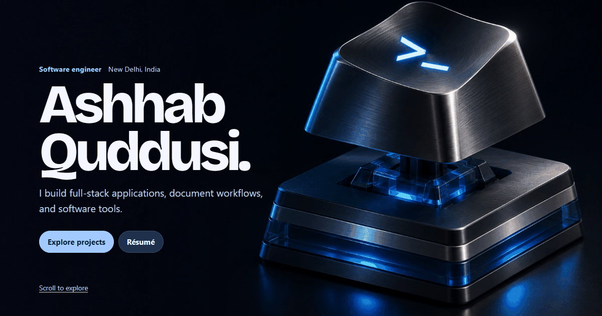

# Ashhab Quddusi’s Portfolio

My developer portfolio brings together six projects, work experience, technical skills, and certifications. It’s built with HTML, CSS, and JavaScript and hosted on Vercel.

[Live portfolio](https://ashhabquddusi.vercel.app/) · [Selected work](https://ashhabquddusi.vercel.app/#projects) · [Certifications](https://ashhabquddusi.vercel.app/#certs) · [Résumé](Ashhab%20Quddusi.pdf)

[](https://ashhabquddusi.vercel.app/)

## Explore the site

- Open the terminal in About and run `help`, `work`, `skills`, or `resume`.
- Scroll down to move through the project cards, filter by category, and open a case study for a technical walkthrough. Every card includes a source link.
- Browse skills by category, open the original credential links, or copy my email from the contact section.
- The layout adapts to mobile and desktop. Light and dark appearance follows the device setting, and the interface uses the system accent when the browser exposes it.

## Run locally

With Python 3 installed, run the following commands. The site needs no build step or application dependencies.

```sh
git clone https://github.com/AshhabQuddusi/Portfolio-Website.git
cd Portfolio-Website
python -m http.server 8000
```

Open the local preview. [http://localhost:8000](http://localhost:8000)

## Source files

| File | What it contains |
| --- | --- |
| [index.html](index.html) | Page content, project case studies, credentials, and links |
| [style.css](style.css) and [script.js](script.js) | Shared layout, colors, skill filters, and email copy |
| [projects.css](projects.css), [projects.js](projects.js), and [project-art.css](project-art.css) | Project explorer, case study dialogs, and cover artwork |
| [terminal.css](terminal.css) and [terminal.js](terminal.js) | Interactive terminal and command handling |
| [Ashhab Quddusi.pdf](Ashhab%20Quddusi.pdf) | Résumé linked from the site |

## Contact

[GitHub](https://github.com/AshhabQuddusi) · [LinkedIn](https://www.linkedin.com/in/ashhab-quddusi/) · [Portfolio contact](https://ashhabquddusi.vercel.app/#contact)

## License

The portfolio source is available under the MIT License. The bundled fonts have their own license files. [Font licenses](assets/fonts/)
